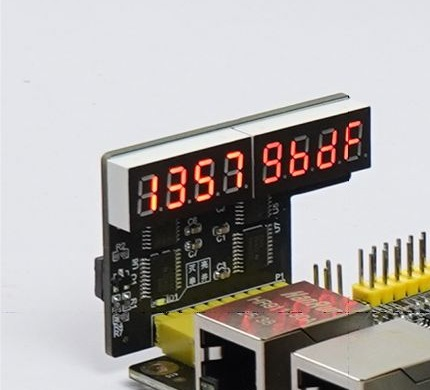

# ACM-HEX8 AXI Display Controller



> ACM-HEX8 V1.0 实物图，摘自小梅哥 FPGA 的
> [官方硬件资料](https://fpga.cn/forum.php?mod=viewthread&tid=30255)。

用于小梅哥 ACM-HEX8 八位数码管模块的 Vivado AXI4-Lite IP，支持：

- 11 线并行模式；
- 74HC595 三线串行模式；
- 8 位段码独立控制；
- 全局亮度调节；
- 可选 Linux platform driver。

已在 AC880（XC7Z020）和 Vivado 2023.2 上验证。

## 配置

双击 IP，根据 ACM-HEX8 模块上的串并转换开关选择：

- `Parallel`：并行模式；
- `Serial`：74HC595 串行模式。

模式必须与模块开关位置一致。

## 寄存器

| 偏移 | 名称 | 说明 |
| --- | --- | --- |
| `0x00` | `CONTROL` | bit0：显示使能 |
| `0x04` | `SCAN_DIV` | 位选扫描分频，默认 6250 |
| `0x08` | `SERIAL_DIV` | 74HC595 时钟分频，默认 25 |
| `0x0C` | `BRIGHTNESS` | 全局亮度，0～255 |
| `0x10` | `SEG0_3` | 左侧第 0～3 位段码 |
| `0x14` | `SEG4_7` | 右侧第 4～7 位段码 |

段码格式为 `{DP,G,F,E,D,C,B,A}`。完整说明见
[寄存器文档](docs/register-map.md)。

## Linux

可选驱动和设备树示例位于 [linux](linux/README.md)。使用前请把设备树基地址改成
Vivado Address Editor 中的实际地址。

## 目录

```text
ip_repo/       可直接加入 Vivado 的打包 IP
rtl/           Verilog 源码
docs/          寄存器说明
linux/         可选 Linux 驱动
scripts/       IP 打包脚本
```
